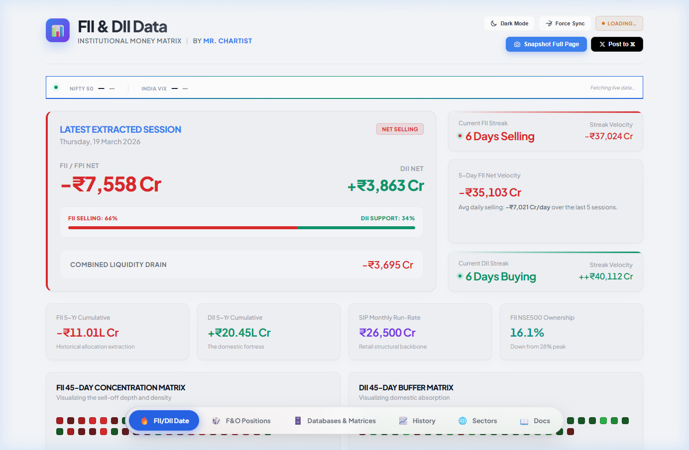
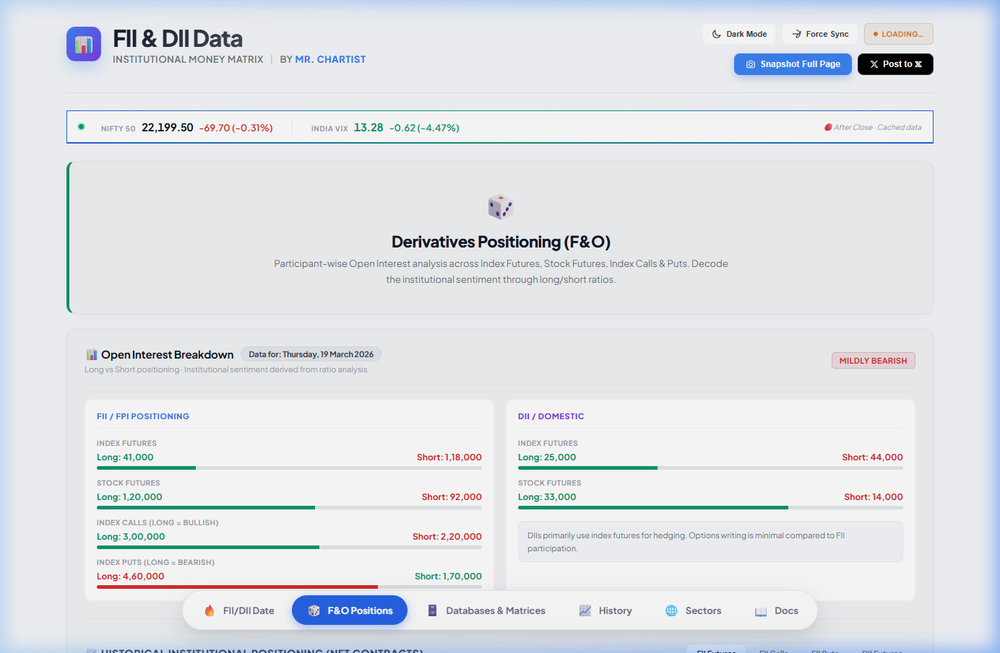
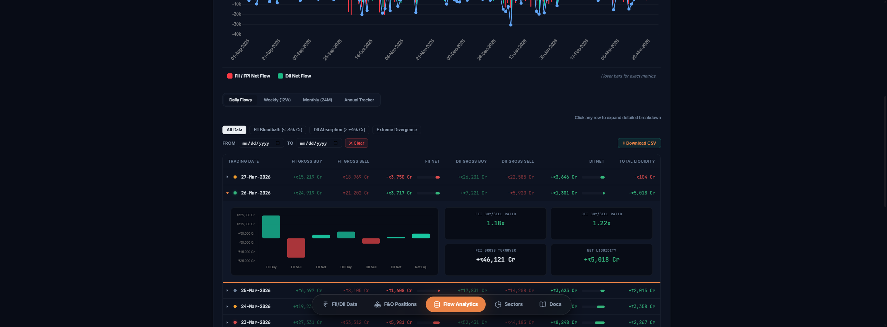
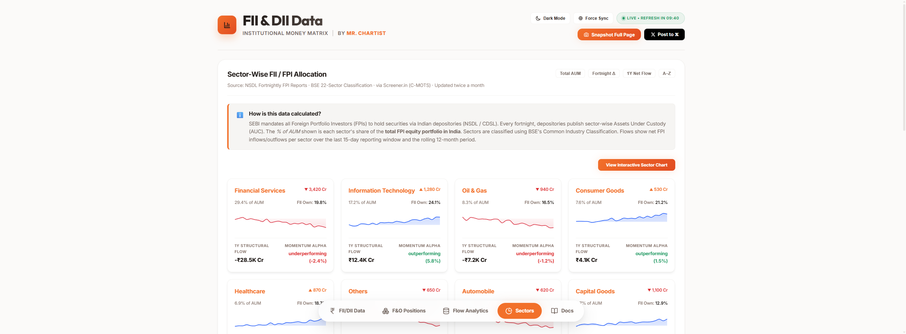
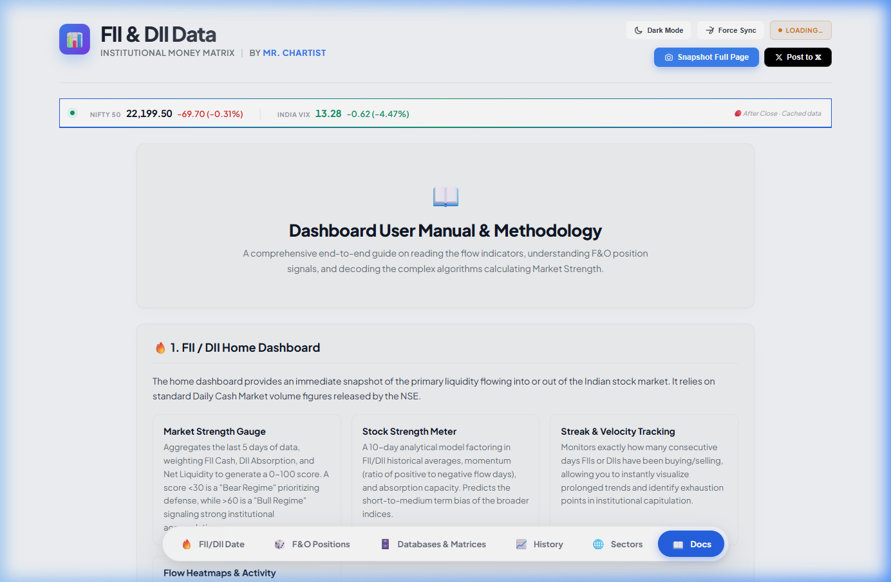

<p align="center">
  
</p>

> **Live Dashboard** for tracking Foreign Institutional Investor (FII/FPI) and Domestic Institutional Investor (DII) flows in Indian equity markets.
>
> Built by [**Mr. Chartist**](https://github.com/MrChartist) | Part of the [Mr. Chartist Ecosystem](https://mrchartist.com)

<p align="center">
  <a href="https://fii-diidata.mrchartist.com/"></a>
  <a href="https://twitter.com/mr_chartist"></a>
  
</p>

---

## ✨ Features

| Feature | Description |
|---------|-------------|
| **Real-Time FII/DII Flows** | Latest net buy/sell data with flow strength meter |
| **45-Day Heatmaps** | GitHub-style concentration matrices for FII sell-off depth & DII absorption |
| **F&O Derivatives** | Participant-wise Open Interest (Long vs Short ratio bars) |
| **Multi-Timeframe Tables** | Daily, Weekly, Monthly & Annual archives with magnitude bars, expandable rows, sortable columns, page-size control, quick date presets and CSV export for every timeframe |
| **Today in context** | 20-session averages, rank of today's move, month-to-date and year-to-date totals on the cash tape |
| **Plain-English reads** | One-line interpretation of FII index-futures positioning ranked against history; sector rotation at a glance |
| **Keyboard shortcuts** | 1-5 jump between sections, t toggles theme, / focuses search, ? shows help |
| **Shareable links** | The URL follows the active section; sector links such as `/#t-sector?s=Financial%20Services` open that sector directly (Copy link in the sector view) |
| **Easy access** | Section jump strip on phones, replayable guided tour, iOS Add-to-Home-Screen hint, high-contrast and reduced-transparency support |
| **Interactive Charts** | Chart.js-powered flow visualizations with timeframe toggles |
| **Sector Allocation** | NSDL fortnightly FPI sector data with sparkline trends & zoom modal |
| **Dark / Light Mode** | OLED black dark mode & clean light theme |
| **Full-Page Export** | html2canvas-powered screenshot & Post to 𝕏 |
| **PWA Installable** | Progressive Web App with offline support |
| **SEO Optimized** | JSON-LD structured data, Open Graph, BreadcrumbList, canonical URL |
| **Security Hardened** | X-Content-Type-Options, X-Frame-Options, Referrer-Policy headers |

---

## 📸 Tab-by-Tab Walkthrough

### 1. FII/DII Data (Home)

The default landing view showing the **latest extracted session** with:

- **Hero Card** — FII/FPI Net vs DII Net with a red/green accent border indicating flow direction
- **Flow Strength Meter** — Visual split showing FII aggression vs DII support percentage
- **Streak Trackers** — Current consecutive buying/selling days with cumulative velocity
- **Quick Stats** — 5-Year cumulative flows, SIP run-rate, FII NSE500 ownership
- **45-Day Heatmaps** — Color-coded concentration matrices (FII sell depth & DII absorption)




---

### 2. F&O Positions

Derivatives positioning analysis with:

- **Sentiment Badge** — Mildly Bearish / Bullish / Neutral classification
- **Open Interest Breakdown** — FII vs DII positioning across Index Futures, Stock Futures, Index Calls & Puts
- **Long vs Short Ratio Bars** — Visual ratio indicators for each instrument
- **Historical Positioning Chart** — 20-period trajectory with toggleable FII Futures, Calls, Puts & DII Futures



---

### 3. Flow Analytics

Complete institutional flow archive with:

- **Interactive FII/DII Chart** — Bar chart with 8-month history, hover for exact metrics
- **Multi-Timeframe Sub-Tabs** — Daily (expandable rows), Weekly (12W), Monthly (24M), Annual Tracker
- **Smart Filters** — FII Bloodbath (< -₹5k Cr), DII Absorption (> +₹5k Cr), Extreme Divergence
- **Date Range Filter** — Custom FROM/TO date filtering
- **CSV Export** — Download filtered data
- **Expandable Row Details** — Click any row for a breakdown chart + buy/sell ratios




---

### 4. Sectors

NSDL Fortnightly FPI Allocation data with:

- **Methodology Explainer** — How SEBI/NSDL sector data is calculated
- **24 Sector Cards** — AUM %, FII Ownership %, sparkline mini-charts, 1Y Flow & Momentum Alpha
- **Zoom Modal** — Click any sector card for a full-screen chart with 24-fortnight trend history, stat pills (1Y Flow, AUM Weight, FII Ownership, Fortnight Flow), hover tooltips
- **Interactive Sector Chart** — Toggleable Bar / Line / Scatter views
- **Sort Modes** — Total AUM, Fortnight Δ, 1Y Net Flow, A-Z
- **Backend Data** — Sector data served via `/api/sectors` endpoint



---

### 5. Docs

Comprehensive documentation covering:

- **Dashboard Architecture** — 5-tab system overview
- **Data Sources** — NSE TRDREQ, NSDL FPI Reports, BSE Classification
- **Methodology** — How FII/DII data is extracted and processed
- **Formulas** — Flow Strength Meter, Momentum Alpha, Streak calculations
- **Export Tools** — Screenshot, CSV, Post to 𝕏



---

## 🛠️ Tech Stack

| Technology | Usage |
|-----------|-------|
| **Node.js + Express** | Backend API server with cron-based NSE data fetching |
| **HTML5** | Single-file dashboard (`public/index.html`) plus `deals.html` |
| **CSS3** | `css/mc.css` design system (tokens, chrome, components) + `css/mc-dashboard.css` (page sections). OLED dark default, warm light theme, safe-area aware |
| **JavaScript** | Vanilla JS with Chart.js 3.9.1; shared chrome, motion, chart theming and range selector live in `public/js/mc-*.js` |
| **Chart.js** | Interactive bar/line charts + sector sparklines |
| **html2canvas** | Full-page screenshot export |
| **node-cron** | Automated data fetching (6:00, 6:30, 7:00 PM IST Mon-Fri) |
| **PWA** | Service Worker v15 (network-first, API bypass) + Web App Manifest with shortcuts |

## 🎨 Design system

The front end ships as two stylesheets and six small scripts, all brand-owned:

| File | Purpose |
|------|---------|
| `public/css/mc.css` | Tokens (colour, type, radius, motion), base styles, navigation (top bar on desktop, iOS-style tab bar on phones), buttons, badges, cards, tables, popovers, modals, footer, deals page |
| `public/css/mc-dashboard.css` | Home command center, F&O, Flow Analytics and Sectors sections, plus their phone layouts |
| `public/js/mc-brand.js` | Brand registry: Mr. Chartist logo lockups, product name, tagline |
| `public/js/mc-ui.js` | Navigation + footer templates, info popovers, menus, live quotes, toast, theme-color sync |
| `public/js/mc-motion.js` | Sliding capsule, scroll reveal, count-ups, battery/data-saver hints |
| `public/js/mc-charts.js` | Chart.js theming from CSS tokens and the Customise sheet (appearance, accent, density, motion, palette) |
| `public/js/mc-ranges.js` | Chart range selector (1M/3M/6M/1Y/All) with empty-state handling and auto-fallback to the latest data |
| `public/js/mc-deals.js` | Bulk & block deals page: filters, search, sortable columns, summary tiles |

Visual language: Liquid Glass in the spirit of the latest iOS and macOS. Surfaces are translucent (`--glass-fill`, about 20% fill in dark) with `backdrop-filter` blur and specular rim highlights over a fixed ambient colour field (`--orb-1…4`). Navigation is a floating capsule on desktop and a floating dock on phones, matching mrchartist.com. The brand accent is `hsl(16 100% 60%)` ("Signal"), the logo stays monochrome, gains/losses use `--os-bull` / `--os-bear`, headings use Plus Jakarta Sans and numerals use Inter with tabular figures. Dark is the default; `html[data-theme="light"]` switches to the paper palette. Browsers without `backdrop-filter` and users with reduced transparency get solid surfaces.

## 📂 Project Structure

```
FII and DII data/
├── server.js                     # Express backend + cron scheduler
├── package.json                  # Dependencies & scripts
├── public/
│   ├── index.html                # Main dashboard (single-file SPA)
│   ├── deals.html                # Bulk & block deals page
│   ├── manifest.json             # PWA manifest (icons, shortcuts)
│   ├── sw.js                     # Service Worker (network-first, API bypass)
│   ├── robots.txt / sitemap.xml  # SEO
│   ├── css/
│   │   ├── mc.css                # Design system + chrome + components
│   │   └── mc-dashboard.css      # Page sections
│   ├── js/
│   │   └── mc-*.js               # Brand, UI chrome, motion, charts, ranges, deals
│   ├── vendor/                   # Self-hosted Chart.js + html2canvas
│   ├── brand/                    # Mr. Chartist logo + app icons (see brand-source/)
│   └── screenshots/              # Tab screenshots for README
├── scripts/
│   ├── fetch_data.js             # NSE data fetcher + JSON storage
│   ├── verify_terminal_ui.js     # Front-end contract test (npm run test:ui)
│   ├── seed_history.js           # Historical data seeder
│   └── seed_sectors.js           # Sector data seeder
├── data/
│   ├── history.json              # Rolling FII/DII daily history
│   ├── sectors.json              # Sector allocation data (24 sectors)
│   └── fetch-log.json            # Fetch activity log
└── README.md                     # This file
```

## 🚀 Quick Start

```bash
# 1. Install dependencies
npm install

# 2. Seed historical data (first time only)
node scripts/seed_history.js
node scripts/seed_sectors.js

# 3. Start the server
npm start
# → Server runs on http://localhost:3000

# 4. Development (auto-reload)
npm run dev
```

## 🔌 API Endpoints

| Method | Endpoint | Description |
|--------|----------|-------------|
| `GET` | `/api/data` | Latest FII/DII snapshot |
| `GET` | `/api/history` | Last 60 days of history |
| `GET` | `/api/history-full` | Full history (800 records) for charts |
| `GET` | `/api/sectors` | Sector allocation with trend data |
| `GET` | `/api/market` | Nifty 50 & India VIX (Yahoo Finance proxy) |
| `GET` | `/api/status` | Server health + recent fetch logs |
| `POST` | `/api/refresh` | Trigger manual NSE data fetch |

## ☁️ Deployment

### Hostinger / VPS
```bash
npm install
NODE_ENV=production node server.js
```
Use a process manager like PM2: `pm2 start server.js --name fii-dii`

### Environment Variables
| Variable | Default | Description |
|----------|---------|-------------|
| `PORT` | `3000` | Server port |

## 📊 Data Flow

```
NSE India API ──→ server.js (cron) ──→ data/history.json
                                    ──→ public/index.html (fetch on load)
                                    ──→ /api/* endpoints

NSDL FPI Reports ──→ seed_sectors.js ──→ data/sectors.json
                                     ──→ /api/sectors
```

## 🔐 Security Headers

All responses include:
- `X-Content-Type-Options: nosniff`
- `X-Frame-Options: SAMEORIGIN`
- `X-XSS-Protection: 1; mode=block`
- `Referrer-Policy: strict-origin-when-cross-origin`
- `Permissions-Policy: camera=(), microphone=(), geolocation=()`

## 🔗 Links

- **Live Dashboard:** [fii-diidata.mrchartist.com](https://fii-diidata.mrchartist.com/)
- **Twitter/X:** [@mr_chartist](https://twitter.com/mr_chartist)

---

## 🤖 Agentic AI Road Map (2026)

**FII & DII Data** serves as our **Regime Detection Feed**. It identifies the institutional context for all other agents.

### Key Agent Integrations:
- **Regime Trigger Agent:** Switches TradeBook's risk parameters to 'Conservative' when institutional sell-off streaks are detected.
- **Sector Rotation Monitor:** Proactively alerts when FPI allocation rotates away from top watchlist sectors.
- **Flow Divergence Alert:** Autonomous signals when FII/DII divergence reaches historical extremes.

---

<p align="center">
  <b>Made with care by <a href="https://github.com/MrChartist">Mr. Chartist</a></b><br>
  <i>Institutional Money Matrix -- Where the smart money flows</i><br><br>
  <a href="https://mrchartist.com"></a>
  <a href="https://github.com/MrChartist"></a>
</p>


---

## License

**Personal use only — no commercial use.** This project is source-available under the
[PolyForm Noncommercial License 1.0.0](https://polyformproject.org/licenses/noncommercial/1.0.0)
with additional terms restricting it to personal, non-commercial use (no organisational use,
no public re-hosting, no resale, no API or data-feed offerings). See [LICENSE](LICENSE).
**Commercial use requires a written licence** — see [COMMERCIAL-LICENSE.md](COMMERCIAL-LICENSE.md). The repository is public to read but closed to changes: see [CONTRIBUTING.md](CONTRIBUTING.md).

Versions published before this change remain under the terms they were released with.
